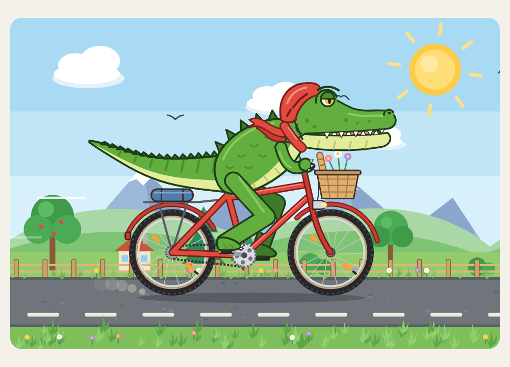

# 鳄鱼骑自行车 · SVG 动画

- **模型**：Claude Fable 5.2（`claude-fable-5-2`）
- **日期**：2026-11-15
- **提示词**：帮我用 svg 画一个鳄鱼骑自行车的动画，越精致越好，不要联网搜索素材

这个模型是在聊天里直接出图的，一共出了三轮，三轮结果都保留在这里。

## 文件

| 文件 | 轮次 | 用户反馈 | 实际表现 |
| --- | --- | --- | --- |
| `v1.html` | 第 1 轮 | "效果一般啊，细节不多" | 能动，画面较简单 |
| `v2.html` | 第 2 轮 | "不是动画了啊，也没有尾巴了" | 静止，尾巴、围巾、辐条、栅栏缺失 |
| `v3.html` | 第 3 轮 | — | 能动，细节完整（最终成品） |
| `preview.png` | — | — | `v3.html` 的静态预览 |

GitHub 上点开 `.html` 只会显示源码，下载后用浏览器打开即可播放。

## 与其他目录的差异

- 成品是内嵌 SVG 的 `.html`，动画由 JS 逐帧驱动（`requestAnimationFrame`），不是 SMIL，所以没有单独的 `.svg` 和 `gen.py`。
- 存成 `.html` 的原因：GitHub 把 `.svg` 当图片展示时不会执行脚本，画面会是静止的。

## 第 2 轮为什么坏了

脚本写在 `<svg>` 内部，里面有 `i<N` 这类"`<` 加字母"的写法，被 HTML 解析器当成标签，整段脚本失效。尾巴、围巾等部件又是脚本生成的，所以一起消失。第 3 轮把这些写法全部换掉，并给尾巴、围巾、腿加了静态默认形状。

## 还原说明

- `v1.html`：当时生成的 SVG 原样，外面加了一层 HTML 外壳。
- `v2.html`：按当时的代码还原（由第 3 轮的代码反向改回原写法），不保证逐字节一致；已用无头 Chrome 确认表现与当时相同：静止、无尾巴。
- `v3.html`：画面与当时一致，区别是脚本移到了 `<svg>` 之外。

## 动画内容（v3）

- 双腿按踏板位置实时做反向运动学，脚跟随踏板，两腿相差 180°
- 曲柄、牙盘、链条、前后车轮联动；路面虚线速度与车轮转速一致
- 尾巴和围巾是逐帧生成的行波路径；头部晃动、下巴开合、定时眨眼，头戴红色头盔
- 车篮（花和法棍）、后货架铺盖卷、挡泥板、水壶、车铃、车灯
- 多层视差背景：云、雪山、两层山丘、小屋和树、栅栏、路边与前景草丛；飞鸟、后轮扬尘、速度线
- 系统开启"减少动态效果"时只渲染一帧
