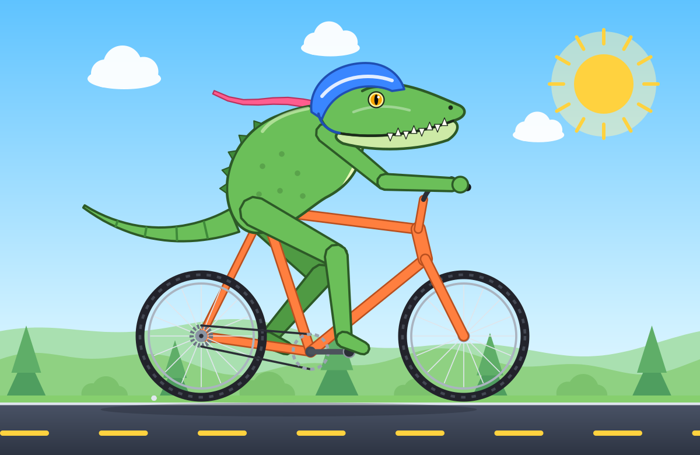

# 鳄鱼骑自行车 · SVG 动画

- **模型**：Claude Haiku 5.5（`claude-haiku-5-5`）
- **日期**：2026-11-15
- **提示词**：帮我用 svg 画一个鳄鱼骑自行车的动画，越精致越好，不要联网搜索素材



## 文件

| 文件 | 说明 |
| --- | --- |
| `crocodile_bike.svg` | 最终成品，浏览器直接打开即可循环播放（SMIL 动画，约 88 KB） |
| `gen.py` | 生成脚本（Python 3，仅标准库），不依赖随机数，重新生成的结果与成品逐字节一致 |
| `preview.png` | 静态预览（t = 0 s 的一帧） |

## 重新生成

```bash
python3 gen.py                 # 输出到脚本同目录的 crocodile_bike.svg
python3 gen.py /tmp/out.svg    # 或指定输出路径
```

## 实现要点

- 纯 SVG 内置 SMIL 动画（`animate` / `animateTransform`），无 JS、无外部素材。
- 双腿用两段骨骼的逆运动学（IK）逐帧求解，每圈 48 个关键帧，脚踝跟随踏板，两腿相差 180°。
- 曲柄、链盘、后飞轮与车轮同为 1 s/圈（1:1 固定齿轮），路面车道虚线的滚动速度（452 px/s）与车轮中心线周长（约 440 px/s）基本一致，相差约 3%。
- 尾巴、围巾为逐帧生成的行波形变，眨眼、头部轻晃、头戴蓝色头盔，车后有扬尘和速度线。
- 背景为多层视差滚动（云、两层山丘、树丛），均为无缝循环。
- 链条为静态直线，没有沿链盘流动。
