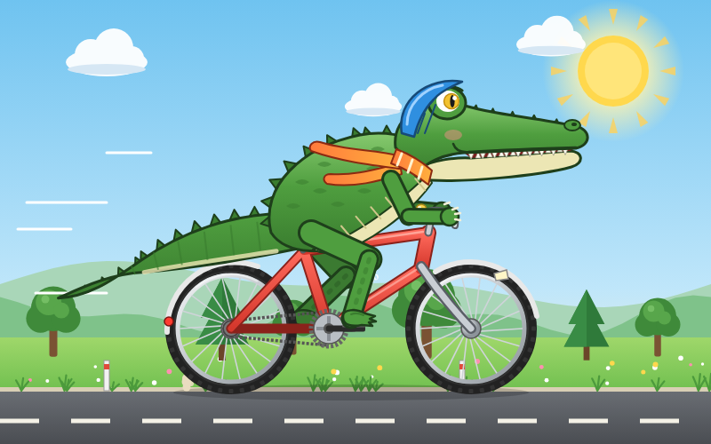

# 鳄鱼骑自行车 · SVG 动画

- **模型**：Claude Opus 5.5（`claude-opus-5-5`）
- **日期**：2026-11-15
- **提示词**：帮我用 svg 画一个鳄鱼骑自行车的动画，越精致越好，不要联网搜索素材



## 文件

| 文件 | 说明 |
| --- | --- |
| `crocodile_bike.svg` | 最终成品，浏览器直接打开即可循环播放（SMIL 动画，约 70 KB） |
| `gen.py` | 生成脚本（Python 3，仅标准库），随机种子固定，重新生成的结果与成品逐字节一致 |
| `preview.png` | 静态预览（t = 0 s 的一帧） |

## 重新生成

```bash
python3 gen.py                 # 输出到脚本同目录的 crocodile_bike.svg
```

## 动画内容

- 双腿用反向运动学预计算 48 个关键帧，脚始终贴合踏板，两腿相差 180° 交替蹬踏
- 曲柄、牙盘、链条、前后车轮联动，尾灯闪烁
- 尾巴摆动、头部晃动、定时眨眼、围巾飘动，头戴蓝色头盔
- 多层视差背景：云、两层远山、树木花草；路面虚线速度与车轮转速同步
- 后轮扬尘、速度线、旋转的阳光
