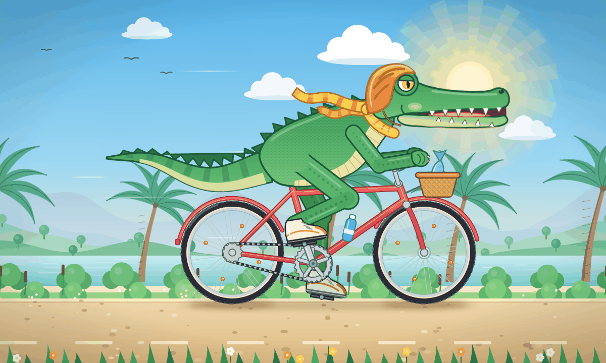

# 鳄鱼骑自行车 · SVG 动画

- **模型**：Claude Sonnet 5.5（`claude-sonnet-5-5`）
- **日期**：2026-11-15
- **提示词**：帮我用 svg 画一个鳄鱼骑自行车的动画，越精致越好，不要联网搜索素材



## 文件

| 文件 | 说明 |
| --- | --- |
| `crocodile_bike.svg` | 最终成品，浏览器直接打开即可循环播放（约 200 KB） |
| `gen.py` | 生成脚本（Python 3，仅标准库），随机种子固定，重新生成的结果与成品逐字节一致 |
| `preview.png` | 静态预览（t = 1.0 s 的一帧） |

## 重新生成

```bash
python3 gen.py                 # 输出到脚本同目录的 crocodile_bike.svg
python3 gen.py /tmp/out.svg    # 或指定输出路径
```

## 实现要点

- 纯 SVG 内置 SMIL 动画（`animate` / `animateTransform`），无 JS、无外部素材。
- 腿和手臂用两段骨骼的逆运动学（IK）逐帧算出关键帧，鞋子跟随踏板并保持水平。
- 曲柄转速为 1.6 s/圈，车轮 2:1 齿比；链条沿路径流动，速度与链盘一致；路面滚动速度与轮胎线速度一致。
- 尾巴和围巾是逐帧生成的行波形变（`d` 属性形变），背景为多层视差滚动，均为无缝循环。
